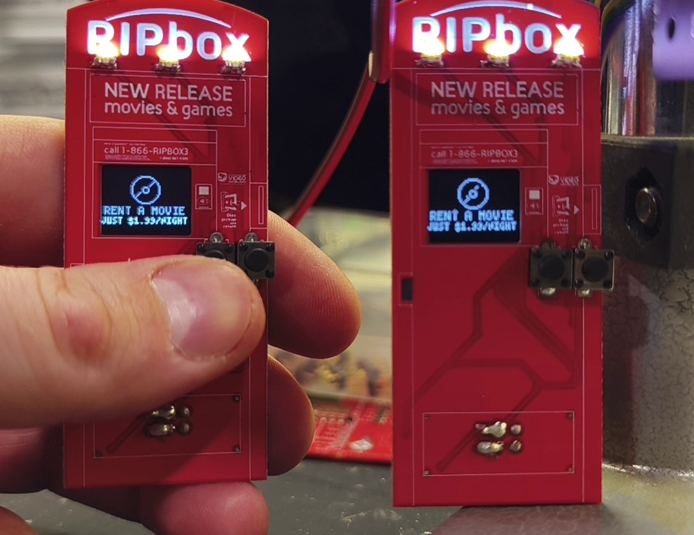

# RIPbox Badge SAO



**RIPbox** is a Redbox-kiosk-shaped Simple Add-On (SAO) badge made for **Hackaday Supercon 2026**. It's a tribute to the late, great Redbox: a tiny DVD rental kiosk with a 64x48 OLED screen, two buttons, and a glowing logo LED, plus a hidden menu where you can **message and ping other RIPboxes**, and play a couple of games.

Everything is open source: firmware, KiCad schematics/PCB, and Gerbers.

> **Heads up:** The Supercon boards handed out at the conference (**Supercon v1.0**) have three hardware bugs, all fixable with a bit of rework. See [Known issues](#known-issues-supercon-v10-hardware). A corrected **v1.1** is planned.

---

## Table of contents

- [What it does](#what-it-does)
- [Versions](#versions)
- [Known issues (Supercon v1.0 hardware)](#known-issues-supercon-v10-hardware)
- [How to use your RIPbox](#how-to-use-your-ripbox)
- [SAO connector pinout](#sao-connector-pinout)
- [Hardware overview](#hardware-overview)
- [Flashing the firmware](#flashing-the-firmware)
- [Setting your Kiosk ID](#setting-your-kiosk-id)
- [How the wireless messaging works](#how-the-wireless-messaging-works)
- [Repository layout](#repository-layout)
- [License and disclaimer](#license-and-disclaimer)

---

## What it does

- **Rental kiosk mode (default):** cycles through fake "rent a movie" ads. Press a button to browse 40 movies, see a fictitious price, and run through a fake payment and disc-dispensing animation.
- **Secret menu (press both buttons, any time):**
  - **Messages:** read messages other RIPboxes sent you (saved in flash).
  - **Scan kiosks:** find nearby RIPboxes, then **send a message** or **ping** one.
  - **Games:** a Flappy-style game and a Breakout-style game.
- **Always-on logo LED** that **flashes** when you get pinged or receive a message.
- Wireless is **ESP-NOW** (no Wi-Fi network, no router, no internet needed).


---

## Versions

| Version | Hardware | Firmware | Status |
|---|---|---|---|
| **Supercon v1.0** | [`hardware/supercon-v1.0`](hardware/supercon-v1.0) | [`firmware/supercon-v1.0`](firmware/supercon-v1.0) | Given out at Supercon 2026. Has [known hardware issues](#known-issues-supercon-v10-hardware). |
| **v1.1** | [`hardware/v1.1`](hardware/v1.1) | [`firmware/v1.1`](firmware/v1.1) | Hardware issues fixed. *Files coming soon.* |

If you got your badge at the conference, you have **Supercon v1.0**.

---

## Known issues (Supercon v1.0 hardware)

The Supercon boards have three errors. None stop the badge from working as a standalone kiosk, but they affect the SAO connector and the logo LED. All are fixed in v1.1.

| # | Issue | Effect | Workaround |
|---|---|---|---|
| 1 | **3.3 V is wired to the SDA and SCL pins** of the SAO connector instead of the far-left pins where power belongs. | The connector isn't powered/wired as the SAO spec expects. | **Bridge the SDA and SCL pins over to the far-left (power) pins** with a jumper wire or solder bridge. |
| 2 | **Schematic error:** the connector's GPIO pins are **not connected to ESP8266 GPIO 1 and 2**. | The SAO GPIO1/GPIO2 pins do nothing. (The stock firmware doesn't use them.) | Add bodge wires if you need them. |
| 3 | **Logo LED polarity is backwards.** | The logo LED won't light. | **Desolder the LED and flip it 180°.** |

Full details are in [`hardware/supercon-v1.0/KNOWN_ISSUES.md`](hardware/supercon-v1.0/KNOWN_ISSUES.md).

---

## How to use your RIPbox

### Controls at a glance

The badge has two buttons: **LEFT** (select) and **RIGHT** (enter).

| Action | What it does |
|---|---|
| **Press both buttons** | Open the **secret menu** (works from any screen). Press both again inside the secret menu to go back to the rental screens. |
| **LEFT (tap)** | In lists: scroll down to the next item |
| **RIGHT (tap)** | In lists: select the highlighted item |
| **LEFT (hold)** | Back / exit the current menu |
| **RIGHT (hold)** | Rental list only: scroll *up* |

### Power on

1. The **RIPbox logo** appears with your three-digit **Kiosk ID** (default **999**).
2. The badge starts the **rental ad animations**. The logo LED is on.

### Renting a movie (the fake kiosk)

1. **Tap any button** during the ads to open the movie list.
2. **LEFT** scrolls, **RIGHT** selects. Long titles scroll sideways. Choose **EXIT** (or hold LEFT) to leave.
3. On the price screen: **LEFT** goes back, **RIGHT** pays.
4. Watch the fake card-swipe and disc-dispensing animation, then it returns to the ads. (No actual movies were harmed. Prices are fictitious.)

The list times out after 30 seconds of inactivity and returns to the ads.

### The secret menu

Press **both buttons** at the same time. The top-right of the screen shows the last two digits of your Kiosk ID.

```
SECRET MENU
├── Messages        read saved messages from other kiosks
├── Scan Kiosks     find RIPboxes in range
│   └── (pick a kiosk)
│       ├── Send Message
│       └── Ping Kiosk
├── Games
│   ├── Flappy RIP
│   └── Block Breaker
└── Exit
```

### Messaging another RIPbox


1. Open the secret menu and choose **Scan Kiosks**. It scans automatically; nearby RIPboxes show up as `KIOSK 042`, etc.
2. Select a kiosk, then choose **Send Message** or **Ping Kiosk**.

**Typing a message** (up to 48 characters):

| Button | Action |
|---|---|
| **LEFT (tap)** | Move to the next character in the selector strip |
| **RIGHT (tap)** | Type the highlighted character |
| **LEFT (hold)** | Type a **space** |
| **RIGHT (hold)** | **Send** the message |

Special characters in the selector strip:

| Symbol | Meaning |
|---|---|
| `<` | Backspace |
| `^` | Toggle CAPS |
| `#` | Exit the editor without sending |

After sending, the badge waits for the other kiosk to confirm and then shows **DELIVERED!** or **NO REPLY** (try again if it's out of range). If delivery fails, your text is kept so you can resend.

**Pinging** works the same way and reports **PING ACKED!** or **NO REPLY**.

### When someone contacts you

The logo LED **flashes** until you press a button:

- **Ping:** the screen shows *"KIOSK ID XXX JUST PINGED YOU!"*. Press any button to dismiss.
- **Message:** the screen shows *"NEW MSG FROM KIOSK ID XXX, PUSH TO VIEW"*. Press any button to read it. It's saved to flash so you can find it later under **Messages**.

Alerts can interrupt anything, including games. If several arrive, they're shown one after another.

### Reading saved messages

Secret menu → **Messages**. Messages are numbered from **1** (oldest). **RIGHT** opens one; inside a message, **RIGHT** goes to the next and **LEFT** goes back. The badge keeps the **last 16 messages**.

### Games

| Game | Controls |
|---|---|
| **Flappy RIP** | **RIGHT** = flap, **LEFT** = exit. On Game Over: RIGHT retries, LEFT exits. |
| **Block Breaker** | Hold **LEFT** to move the paddle left, hold **RIGHT** to move right. You get 3 lives. Press both buttons to leave. |

### Troubleshooting

| Problem | Try this |
|---|---|
| **No kiosks found** | Both badges need the RIPbox firmware, and must be reasonably close. Scanning repeats every 1.5 seconds, so give it a few seconds. |
| **Messages go to the wrong badge** | If two badges share a Kiosk ID (e.g. both still 999), both will receive messages sent to it. Give each badge a [unique ID](#setting-your-kiosk-id). |
| **Logo LED never lights** | You have a Supercon v1.0 board: [flip the LED](#known-issues-supercon-v10-hardware). |
| **Text doesn't fit / looks off** | Open an issue with a photo of your board and the version you have. |

---

## SAO connector pinout

RIPbox uses the standard 6-pin SAO connector.

| Pin | Name | Description |
|:-:|---|---|
| 1 | **VCC** | 3.3 V power |
| 2 | **GND** | Ground |
| 3 | **SDA** | I²C data |
| 4 | **SCL** | I²C clock |
| 5 | **GPIO1** | General-purpose I/O |
| 6 | **GPIO2** | General-purpose I/O |

```
   far left                    far right
  ┌────────┬────────┬────────┐
  │ 1 VCC  │ 3 SDA  │ 5 IO1  │
  ├────────┼────────┼────────┤
  │ 2 GND  │ 4 SCL  │ 6 IO2  │
  └────────┴────────┴────────┘
```

> Check the pin-1 marking on your board's silkscreen before connecting anything. On **Supercon v1.0**, 3.3 V landed on the SDA/SCL pins and the GPIO pins aren't connected to the ESP8266. See [Known issues](#known-issues-supercon-v10-hardware).

---

## Hardware overview

| Part | Details |
|---|---|
| MCU | ESP8266 |
| Display | SSD1306 **64x48** OLED, I²C address **0x3C** (I²C on the ESP8266 default pins: GPIO4 = SDA, GPIO5 = SCL) |
| Button 1 (LEFT / select) | **GPIO12**, internal pull-up, active low |
| Button 2 (RIGHT / enter) | **GPIO13**, internal pull-up, active low |
| Logo LED | **GPIO14**, drive **high** = on |

KiCad projects, PDF schematics and Gerbers live in [`hardware/`](hardware). See [`hardware/README.md`](hardware/README.md) for ordering the PCB.

---

## Flashing the firmware

The firmware is a single Arduino sketch: [`firmware/supercon-v1.0/ripbox_badge/ripbox_badge.ino`](firmware/supercon-v1.0/ripbox_badge/ripbox_badge.ino).

1. Install the **Arduino IDE**.
2. Add ESP8266 board support: *File → Preferences → Additional Boards Manager URLs*, add
   `http://arduino.esp8266.com/stable/package_esp8266com_index.json`, then *Tools → Board → Boards Manager* and install **esp8266**.
3. Install the **U8g2** library (*Tools → Manage Libraries*).
4. Open `ripbox_badge.ino`, select your ESP8266 module under *Tools → Board* (for example *Generic ESP8266 Module*) and the right serial port.
5. Connect a **3.3 V** USB-serial adapter to the badge, put the ESP8266 into its bootloader (GPIO0 held low while resetting/powering up), and click **Upload**.

The ESP8266 is a **3.3 V** device. Do not use 5 V serial adapters.

---

## Setting your Kiosk ID

The Kiosk ID is a number from **1 to 999** stored in the ESP8266's flash (emulated EEPROM). The default is **999**.

**Using the serial monitor** (115200 baud, newline line ending):

```
id 123        set this badge's Kiosk ID to 123
clear         erase all saved messages
```

**For developers:** the ID is stored at **EEPROM address 1 (low byte) and 2 (high byte)**, with a magic byte `0xA5` at address 0. Saved messages start at address 18. The full map is at the top of the `.ino` file.

---

## How the wireless messaging works

- Uses **ESP-NOW** on Wi-Fi channel 1. It runs in the background all the time, so badges can find, ping and message each other whenever they're on.
- Every packet is a **broadcast** that carries the sender ID and the destination ID. Badges ignore packets not addressed to them.
- Because broadcasts have no built-in confirmation, the receiver sends back an **ACK**. The sender retries up to 4 times (about 2 seconds) before showing **NO REPLY**.
- **Scan** sends a discovery request; every RIPbox in range answers after a short random delay so replies don't collide.
- Duplicate retries are filtered so you only get one alert per message.

---

## Repository layout

```
RIPbox-Badge-SAO/
├── README.md
├── LICENSE
├── .gitignore
├── firmware/
│   ├── supercon-v1.0/
│   │   └── ripbox_badge/
│   │       └── ripbox_badge.ino      # Arduino sketch (Supercon boards)
│   └── v1.1/                         # coming soon
├── hardware/
│   ├── README.md                     # how to open / order the boards
│   ├── supercon-v1.0/
│   │   ├── KNOWN_ISSUES.md           # the 3 bugs + rework instructions
│   │   ├── kicad/                    # KiCad project files
│   │   ├── schematics/               # PDF schematic exports
│   │   └── gerbers/                  # fabrication files
│   └── v1.1/                         # fixed hardware (coming soon)
│       ├── kicad/
│       ├── schematics/
│       └── gerbers/
└── images/
    ├── board.jpg                     # main photo of the board
    ├── main_screen.gif               # rental / ad animations
    └── messaging.gif                 # two badges messaging
```

---

## License and disclaimer

- **Firmware:** MIT. See [`LICENSE`](LICENSE).
- **Hardware (schematics, PCB, Gerbers):** *license to be chosen. Update this line before publishing (for example CERN-OHL-P-2.0).*

RIPbox is a fan-made tribute and parody project. It is **not affiliated with, endorsed by, or connected to Redbox** or any of its owners. All movie titles belong to their respective rights holders and appear only as flavor text; prices and payments are entirely fictitious.

- Claude Code
Parts of this repository and code was created with the assistance of Claude, please see the included prompt file with the code for details on how it was originally produced for transparency.

*Made for Hackaday Supercon 2026. Rest in peace, Redbox.* 📼
